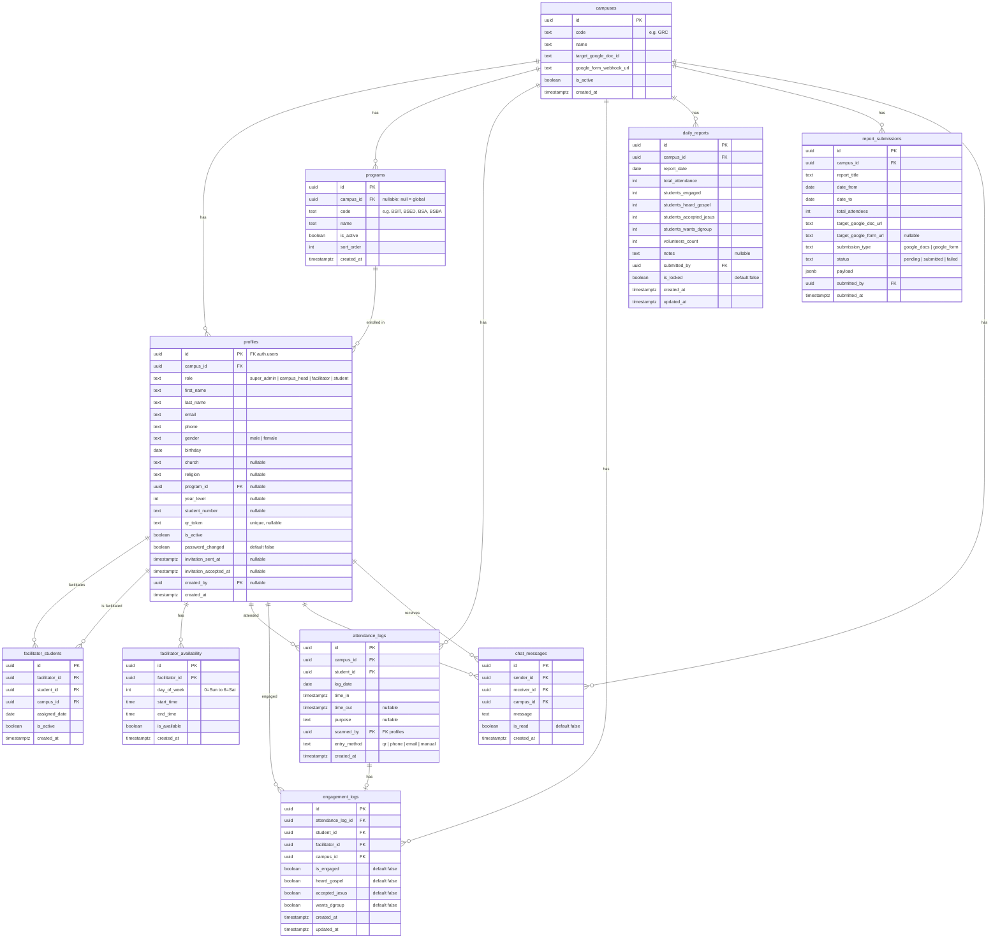

# Elevate Campus Hub — System Specification & Architecture Plan

**System Name:** Elevate Campus Hub  
**Initial Campus Rollout:** Global Reciprocal Colleges (GRC)  
**System Language:** English  
**Architecture:** Multi-Tenant Multi-Campus Ready (Tenant Key: `campus_id`)  

---

## 1. Executive Summary & Objective

**Elevate Campus Hub** is a centralized, multi-campus web application designed to track student attendance, spiritual engagement milestones, facilitator assignments, and automated external ministry reporting.

The system is optimized for **100% free-tier operation** using **Next.js (App Router)**, **Supabase (PostgreSQL, Auth, Realtime)**, and **Vercel** with scheduled keep-alive ping mechanisms to prevent database inactivity pausing.

---

## 2. Tech Stack & Integration Ecosystem

| Component | Technology | Rationale & Specifications |
|---|---|---|
| **Frontend & Backend** | Next.js 14+ (App Router, TypeScript) | Server Actions for mutations, Route Handlers for webhooks/cron, Server Components for high-performance SSR. |
| **Styling & UI** | Tailwind CSS & shadcn/ui + Lucide Icons | Responsive mobile-first interface suitable for phone scans and desktop admin dashboards. |
| **Database & Auth** | Supabase (PostgreSQL, Realtime, Auth) | Relational integrity, Row Level Security (RLS), real-time WebSocket subscriptions for messaging. |
| **QR Code Generation** | `qrcode.react` | Generates high-contrast downloadable/printable student QR cards with unique tokens. |
| **QR Code Scanning** | `@yudiel/react-qr-scanner` | Camera scanner with fallback input for phone number or email lookup. |
| **Reporting Automation** | Google Apps Script Webhook | Programmatically appends reports to external Google Docs and submits to Google Forms. |
| **Hosting & Scheduling** | Vercel (Hobby Tier) | Vercel Cron jobs trigger keep-alive endpoint every 3 days. |

---

## 3. User Roles & Permission Matrix

The application supports four distinct user roles:

1. **Super Admin (IT Access):**
   - Full global access across all campuses.
   - Manages campuses and campus configurations.
   - Manages dynamic academic programs and courses.
   - Directly resets student or staff passwords (bypassing email requirements).
   - Monitors system logs, cron keep-alive status, and user directory.

2. **Campus Head:**
   - Operational manager for their designated campus (e.g., GRC).
   - Creates and manages Facilitator and Student accounts.
   - Views registered students and pending invitations (with resend capability).
   - Scans attendance and performs student facilitation/engagement.
   - Reviews, edits, and locks the Daily Report.
   - Submits automated reports to external Google Docs and Google Forms.
   - Views facilitator schedules and availability.

3. **Facilitator / Volunteer:**
   - Enters attendance via QR scanner or phone/email fallback.
   - Instantly registers first-time visitors and marks their attendance.
   - Conducts engagement assessments (Engaged, Gospel heard, Accepted Jesus, Wants D-Group).
   - Sets personal weekly availability hours.
   - Communicates with assigned students via real-time same-gender chat.

4. **Student:**
   - Accesses personalized profile (Course, Year, Student Number).
   - Views assigned facilitator information.
   - Downloads/views unique personal QR Attendance Card.
   - Communicates with same-gender facilitator via chat.
   - Views past attendance records.

### Permission Matrix Table

| Feature / Action | Super Admin (IT) | Campus Head | Facilitator | Student |
|---|:---:|:---:|:---:|:---:|
| System-wide settings & Campuses | **Full** | None | None | None |
| Dynamic Programs/Courses Management | **Full** | Read | Read | Read |
| Direct Password Reset (Any User) | **Full** | None | None | None |
| Create Facilitator Accounts | Yes | Yes | None | None |
| Create Student Accounts | Yes | Yes | Yes | None |
| View Pending Student Invitations & Resend | Yes | Yes | None | None |
| Mark Attendance (QR / Phone / Email) | None | Yes | Yes | None |
| Mark Engagement Survey (4-step flow) | None | Yes | Yes | None |
| View & Edit Daily Report | Read | **Full** | None | None |
| Submit Report to Google Docs / Form | None | Yes | None | None |
| Set Availability Schedule | None | Yes | Yes | None |
| Real-Time Chat (Strictly Same-Gender) | None | None | Yes | Yes |
| View Own QR Card & Profile | None | None | None | Yes |

---

## 4. Database Schema (Supabase PostgreSQL)



---

## 5. Detailed System Workflows

### 5.1 Account Provisioning & Registration Flow
- **Campus Head & Facilitator Creation:** Super Admin creates Campus Head; Campus Head creates Facilitators.
- **First-Timer Student Flow:**
  1. Facilitator opens the attendance scanner and selects **"First Timer"** registration.
  2. Enters student details: First Name, Last Name, Phone Number, Email, Gender (Male/Female), Birthday, Program (BSIT, BSED, BSA, BSBA, or custom), Year Level, Church (optional), Religion (optional).
  3. System creates a pending Supabase Auth account and fires an invitation email.
  4. Unique `qr_token` (UUID) is generated and stored in `profiles`.
  5. The student is **immediately marked as Present** (`time_in = NOW()`) for that day.
  6. The student receives a registration email with a link to set their personal password.
  7. **Unaccepted Invitation Handling:** If a student hasn't accepted yet, their attendance remains valid, a "Pending Invitation" badge appears in Campus Head's portal, and Campus Head can click "Resend Invitation".
- **IT Direct Password Reset:** Super Admin has direct access to override passwords for any student without needing email verification.

### 5.2 QR & Fallback Attendance Flow
- **Scanning Mode:** Camera detects QR containing the student's `qr_token`.
- **Lookup & Toggle Logic:**
  - System checks for an existing record in `attendance_logs` matching `student_id` and `CURRENT_DATE`.
  - **If no record exists:** Inserts a new row with `time_in = NOW()`.
  - **If open record exists (`time_out IS NULL`):** Updates existing record with `time_out = NOW()`.
- **No-Phone / No-QR Fallback:** Facilitator can toggle to manual input and enter the student's **Phone Number** or **Email Address** to look up their profile and mark attendance.

### 5.3 Batch Engagement Tracking (Facilitator Experience)
- Facilitator views their "Today's Batch" list of students checked in.
- Clicking a student's nickname opens a structured, clean multi-step dialog:
  - **Question 1:** "Did you engage with this student today?" (Yes / No)
    *(If No, remaining questions are skipped and logged as false).*
  - **Question 2:** "Did they hear the Gospel?" (Yes / No)
  - **Question 3:** "Did they accept Jesus Christ?" (Yes / No)
  - **Question 4:** "Do they want to join a Discipleship Group (D-Group)?" (Yes / No)
- Submitting updates `engagement_logs` instantly and shows a checkmark badge on the student's badge.

### 5.4 Daily Reporting & Automated External Submissions
- **Auto-Calculations:**
  - Total Attendance: `COUNT(DISTINCT student_id)` on date.
  - Students Engaged: `COUNT` where `is_engaged = true`.
  - Gospel Heard: `COUNT` where `heard_gospel = true`.
  - Accepted Jesus: `COUNT` where `accepted_jesus = true`.
  - Wants D-Group: `COUNT` where `wants_dgroup = true`.
  - Volunteers Count: Distinct count of `scanned_by` facilitators who checked in students on that date.
- **Campus Head Review:** Campus Head can review and manually adjust figures before finalizing.
- **External Google Docs Submission:**
  - Campus Head inputs target Google Doc URL.
  - Regex extracts Google Doc ID: `/\/d\/([a-zA-Z0-9-_]+)/`.
  - System calls Google Apps Script Webhook with JSON payload.
  - Apps Script appends formatted markdown/text report into the Google Doc.
- **External Google Form Automation:**
  - System prepares the aggregated JSON payload.
  - User reviews summary and clicks "Submit Report".
  - Webhook forwards data to Google Apps Script which submits the Form via FormApp.

### 5.5 Same-Gender Real-Time Chat System
- Students can chat with their facilitator to ask questions, receive encouragement, or coordinate D-Group meetings.
- **Strict Gender Filter:**
  - A male student can only chat with a male facilitator.
  - A female student can only chat with a female facilitator.
  - RLS policies and UI filters block cross-gender messaging.
- Messages sync in real-time via Supabase Realtime channel subscriptions.

### 5.6 Super Admin Dynamic Programs (Courses)
- Super Admin navigates to `/admin/programs`.
- Can add, rename, re-order, or deactivate programs (e.g., BSIT, BSED, BSA, BSBA, BSCpE).
- Registration dropdowns dynamically query active programs, avoiding hardcoded code changes.

---

## 6. Hosting, Database Keep-Alive & Free-Tier Optimization

### 6.1 Supabase Free-Tier Inactivity Issue
Supabase free tier automatically pauses projects that have zero database queries for 7 consecutive days. Because Elevate Campus Hub operates actively once a week (e.g., every Friday or Saturday), an automatic keep-alive ping is mandatory.

### 6.2 Keep-Alive Implementation
1. **API Endpoint:** `/api/cron/keep-alive` executes a lightweight query (`SELECT id FROM campuses LIMIT 1`).
2. **Vercel Cron (`vercel.json`):**
   ```json
   {
     "crons": [
       {
         "path": "/api/cron/keep-alive",
         "schedule": "0 0 */3 * *"
       }
     ]
   }
   ```
   Runs every 3 days at midnight UTC to guarantee the Supabase instance never goes to sleep.
3. **Security:** Secured using Vercel's automated `CRON_SECRET` header validation.

---

## 7. Environment Variables Configuration

Create a `.env.local` file for development and configure matching variables in Vercel:

```env
# Supabase Configuration
NEXT_PUBLIC_SUPABASE_URL=https://<your-project-id>.supabase.co
NEXT_PUBLIC_SUPABASE_ANON_KEY=<your-anon-key>
SUPABASE_SERVICE_ROLE_KEY=<your-service-role-key>

# Campus Configuration
NEXT_PUBLIC_DEFAULT_CAMPUS_CODE=GRC

# Google Services Webhook
GOOGLE_APPS_SCRIPT_WEBHOOK_URL=https://script.google.com/macros/s/<deployment-id>/exec

# Cron Security
CRON_SECRET=<your-random-32-char-secret>
```

---

## 8. Google Apps Script Webhook Code (`Code.gs`)

Deploy as a Web App with access set to **"Anyone"**:

```javascript
function doPost(e) {
  try {
    var data = JSON.parse(e.postData.contents);
    
    if (data.type === 'docs') {
      return handleDocAppend(data);
    } else if (data.type === 'form') {
      return handleFormSubmit(data);
    }
    
    return ContentService.createTextOutput(JSON.stringify({ success: false, error: 'Unknown type' }))
      .setMimeType(ContentService.MimeType.JSON);
  } catch (err) {
    return ContentService.createTextOutput(JSON.stringify({ success: false, error: err.toString() }))
      .setMimeType(ContentService.MimeType.JSON);
  }
}

function handleDocAppend(payload) {
  var doc = DocumentApp.openById(payload.docId);
  var body = doc.getBody();
  
  body.appendParagraph("═════════════════════════════════════════════");
  body.appendParagraph("ELEVATE CAMPUS HUB — ATTENDANCE & MINISTRY REPORT");
  body.appendParagraph("Campus: " + (payload.campusName || "GRC"));
  body.appendParagraph("Date Range: " + payload.dateFrom + " to " + payload.dateTo);
  body.appendParagraph("Total Attendance: " + payload.totalAttendance);
  body.appendParagraph("Students Engaged: " + payload.studentsEngaged);
  body.appendParagraph("Gospel Heard: " + payload.studentsHeardGospel);
  body.appendParagraph("Accepted Jesus: " + payload.studentsAcceptedJesus);
  body.appendParagraph("Wants D-Group: " + payload.studentsWantsDgroup);
  body.appendParagraph("Active Volunteers: " + payload.volunteersCount);
  body.appendParagraph("Submitted By: " + payload.submittedBy);
  body.appendParagraph("Timestamp: " + new Date().toISOString());
  body.appendParagraph("═════════════════════════════════════════════\n");
  
  doc.saveAndClose();
  return ContentService.createTextOutput(JSON.stringify({ success: true }))
    .setMimeType(ContentService.MimeType.JSON);
}

function handleFormSubmit(payload) {
  // Form submission mapping will be configured once target Google Form fields are provided
  return ContentService.createTextOutput(JSON.stringify({ success: true, message: 'Form submission endpoint ready' }))
    .setMimeType(ContentService.MimeType.JSON);
}
```

---

## 9. Implementation Roadmap & Execution Checklist

1. **Phase 1: Project Scaffolding & Dependencies**
   - Initialize Next.js 14+ App Router with TypeScript & Tailwind CSS.
   - Install shadcn/ui primitives, Lucide icons, `@supabase/supabase-js`, `@supabase/ssr`, `qrcode.react`, `@yudiel/react-qr-scanner`.
2. **Phase 2: Database & Security Migrations**
   - Execute SQL migrations creating all 10 tables, triggers, and Row Level Security policies.
   - Seed GRC campus and default programs (BSIT, BSED, BSA, BSBA).
3. **Phase 3: Authentication & Middleware**
   - Configure Supabase SSR client, session refresh middleware, and role-based route guards.
4. **Phase 4: Dashboard Shell & Role-Based Navigation**
   - Implement responsive sidebar and header with active campus display.
5. **Phase 5: User Management & Dynamic Programs**
   - Student registration, pending invitation tracker, resend email, Super Admin password reset tool, and dynamic courses CRUD.
6. **Phase 6: QR & Fallback Attendance Scanner**
   - Camera scanner with automatic toggle logic, manual phone/email search, and first-timer fast registration.
7. **Phase 7: Engagement Flow Modal**
   - Sequential 4-question modal tied to today's batch of attended students.
8. **Phase 8: Daily Report & External Submissions**
   - Auto-aggregations, Campus Head manual edit/override, Google Docs regex extractor, and webhook dispatcher.
9. **Phase 9: Real-Time Same-Gender Chat**
   - Filtered contact list, Supabase Realtime message stream, and unread counts.
10. **Phase 10: Facilitator Availability & Student Portal**
    - Weekly schedule editor and student profile card with QR code download.
11. **Phase 11: Deployment & Keep-Alive Cron**
    - Configure `vercel.json`, deploy to Vercel, and verify the keep-alive route.

